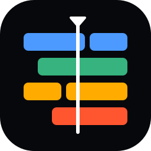
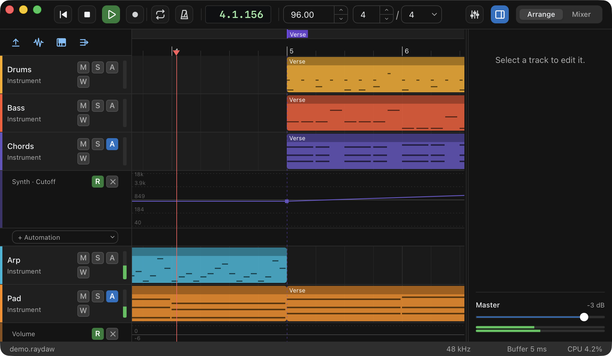
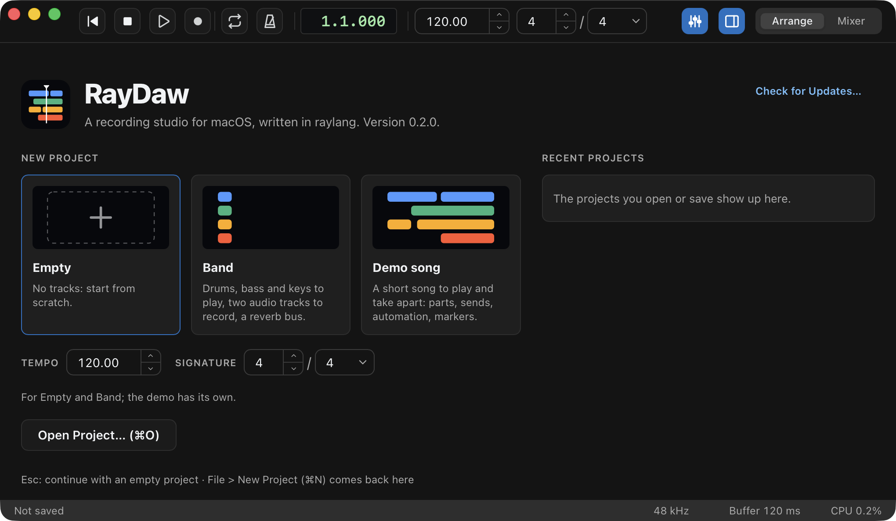
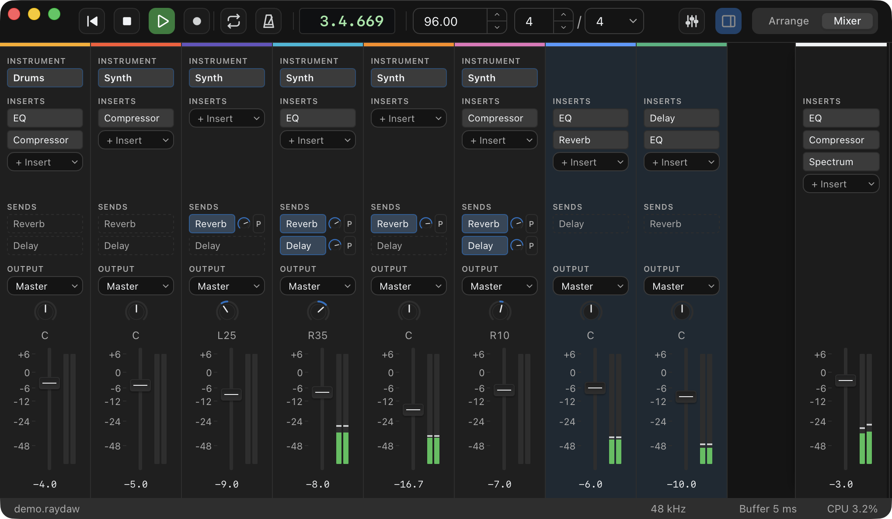
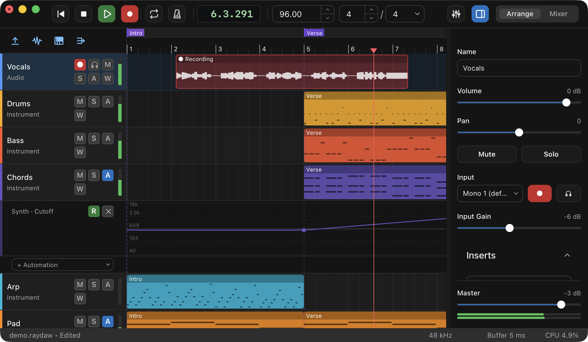
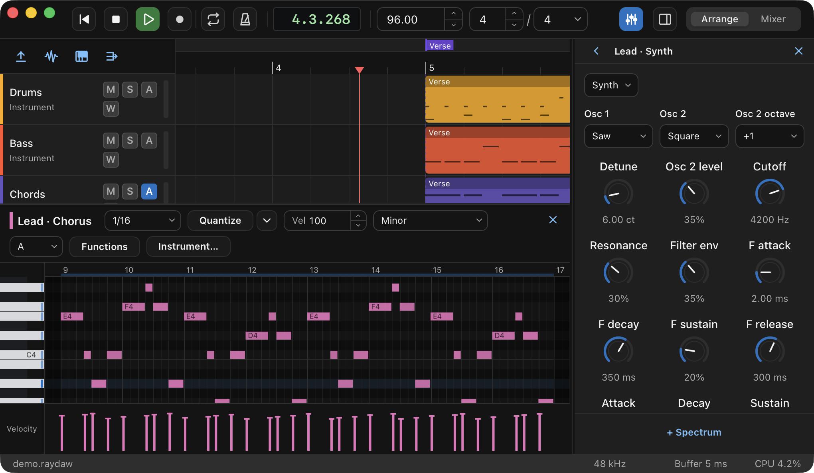

<p align="center">
  
</p>

<h1 align="center">RayDaw</h1>

<p align="center"><b>A recording and mixing studio for macOS, written in <a href="https://github.com/ray-language/raylang">raylang</a>.</b></p>

RayDaw is a digital audio workstation in the spirit of Cubase: an arrange window with audio and
instrument tracks, a mixer with its own effects, a key editor, automation, and audio recording
from a microphone or an interface. The audio engine, the effects, the synthesizer and the drum
machine are all written in raylang; the interface is [ray-elements](https://github.com/ray-language/elements).

<p align="center">
  
</p>

This repository holds the **published builds** and the files RayDaw downloads to update itself.
The source lives in a private repository.

## Install

On a Mac with Apple silicon:

```sh
curl -fsSL https://github.com/ray-language/ray-daw-releases/releases/latest/download/install.sh | sh
```

The script reads the release manifest, downloads the zip, checks its SHA-256 against the manifest
before unpacking anything, and puts `RayDaw.app` in `/Applications` (or in `~/Applications` when
`/Applications` is not writable). `RAYDAW_VERSION=0.2.0` installs that version instead of the
latest; `RAYDAW_DIR=<folder>` installs it somewhere else. To install by hand, download the zip from
the [latest release](https://github.com/ray-language/ray-daw-releases/releases/latest), unzip it
and drag `RayDaw.app` to Applications.

The app is signed with a Developer ID and notarized by Apple, so it opens without Gatekeeper
asking. The first time a track is armed, macOS asks for permission to use the microphone.

## Updates

RayDaw looks for a newer version once a day and only speaks up when there is one: a notice offers
**Install and Relaunch**, **What's new** and **Later**. *RayDaw › Check for Updates…* (or the
button on the start page) looks right away. Nothing is installed without your click; with unsaved
changes it asks first.

An update is installed only when the manifest's Ed25519 signature matches the key built into the
app and the zip's size and SHA-256 match the manifest. From a terminal:

```sh
/Applications/RayDaw.app/Contents/MacOS/RayDaw --self-update
```

## Plug-ins

RayDaw plays the Audio Unit and VST3 plug-ins installed on the Mac, as effects (*+ Insert*) and as
instruments (an instrument track's instrument selector). It ships none of its own; any plug-in
built for Apple silicon (`arm64` or universal) will do. It looks for them in:

| Format | For you (no password) | For every user |
|---|---|---|
| Audio Unit (`.component`) | `~/Library/Audio/Plug-Ins/Components` | `/Library/Audio/Plug-Ins/Components` |
| VST3 (`.vst3`) | `~/Library/Audio/Plug-Ins/VST3` | `/Library/Audio/Plug-Ins/VST3` |

**Installing one.** Use the plug-in's installer, or, when it offers a zip or disk image, copy the
`.component` or `.vst3` bundle into the folder for you (create `~/Library/Audio/Plug-Ins/VST3` if
it is missing). Restart RayDaw: it reads the list once per session. Third-party Audio Units run in
a process of their own, so one that crashes does not take RayDaw down; VST3 plug-ins run inside
RayDaw.

**Checking it.** This loads every plug-in (or those whose name, vendor or id contains the filter)
the way RayDaw does, runs two seconds of signal through it and prints one line each: `ok`, or what
went wrong.

```sh
/Applications/RayDaw.app/Contents/MacOS/RayDaw --check-plugins surge
```

**Removing one.** Delete its bundle from the folder it was copied to (only that bundle: other apps
keep theirs there too), or run the uninstaller it came with, and restart RayDaw. A project that
used it still opens: its slot passes the signal through and says the plug-in is missing, and its
settings are kept for when it is back.

**Free plug-ins to try.** RayDaw's plug-in support was tested with these; each one's release has a
macOS download whose bundles can be copied as above.

| Plug-in | Kind | Formats | License |
|---|---|---|---|
| [Surge XT](https://github.com/surge-synthesizer/releases-xt/releases) and Surge XT Effects | synthesizer; effects | AU, VST3 | GPL-3.0 |
| [Dexed](https://github.com/asb2m10/dexed/releases) | FM synthesizer | AU, VST3 | GPL-3.0 |
| [Airwindows Consolidated](https://github.com/baconpaul/airwin2rack/releases/tag/DAWPlugin) | hundreds of effects in one | AU, VST3 | MIT |
| [CHOWTapeModel](https://github.com/jatinchowdhury18/AnalogTapeModel/releases) | tape saturation | AU, VST3 | GPL-3.0 |
| [Dragonfly Reverb](https://github.com/michaelwillis/dragonfly-reverb/releases) (Hall, Room, Plate, Early Reflections) | reverbs | VST3 | GPL-3.0 |

Loading several Dragonfly reverbs prints `Class DGL_Pugl… is implemented in both` in the terminal:
they share code, and it is harmless. **Dragonfly Early Reflections hangs RayDaw when its editor is opened**
(a bug of the plug-in: Steinberg's own example host hangs the same way, and the other three
open fine; [its issue](https://github.com/michaelwillis/dragonfly-reverb/issues/169)); as an
insert it works, and its parameters can be automated from *+ Automation*. If it hangs RayDaw, force
RayDaw to quit (⌥⌘⎋): it kept a recovery copy of the unsaved changes, and it asks before opening
that editor again.

## Versions

### 0.4.0 · 23 November 2026

**Plug-ins**
- Audio Unit (v2 and v3) and VST3 effects as inserts on every channel and on the master, marked
  *AU* or *VST3* in the list; *Open Editor* opens the plug-in's own window.
- Audio Unit and VST3 instruments on instrument tracks, played sample-accurately by the parts and
  the on-screen keyboard; stopping, locating or cycling releases their notes, and their tails ring
  out, in the export too.
- A plug-in's settings are saved with the project, with every autosave and undo step. One that is
  not installed passes the signal through and says so.
- Delay compensation: a plug-in that delays its signal no longer puts the mix out of step, and
  what you hear is where the playhead is. The channel editor shows each plug-in's latency.
- Automation of plug-in parameters, drawn with the plug-in's own values and units; a track in
  **W** writes what you move in the plug-in's window.
- A plug-in that hangs RayDaw: after 5 s without an answer from the window, RayDaw writes the
  recovery copy of the unsaved changes; a plug-in whose editor froze it is remembered, and asking
  for that editor again asks first; the plug-ins are listed in a separate process, so one that
  crashes or hangs there is left out, not RayDaw.
- *+ Automation* and *+ Insert* have a search field that filters the list as you type.
- `--check-plugins [filter]` tests the installed plug-ins without opening a window.
- Built with raylang 1.27.111.

### 0.3.0 · 21 November 2026

**Projects**
- *File › Open Recent* is a submenu, with *Clear Menu*; the recent projects are also in the
  command palette.
- Opened and saved projects appear among macOS's recent documents: the Dock menu of RayDaw,
  *Apple menu › Recent Items* and Finder.
- A `.raydaw` project opens from Finder (*Open With*) or dropped on the Dock icon.

**Recording**
- Built with raylang 1.27.111, which corrects how a take is aligned with what plays. If you
  measured a Record Offset with 0.2.0, measure it again: *Audio › Recording Settings…*.
- The live waveform of a take no longer runs ahead of the playhead when the input gain is
  changed or a track is armed while recording.
- Input gain and volume show one decimal.

**App**
- The icon has its simplified version at the small sizes (Finder lists, menus).

### 0.2.0 · 20 November 2026

The first published version.

<p align="center">
  
  
</p>

**Start page (Hub)**
- New project from *Empty*, *Band* (drums, bass and keys to play, two audio tracks to record, a
  reverb bus) or the *Demo song* (17 bars in A minor, with sections, sends, automation and markers).
- Tempo and time signature chosen up front; recent projects; recovery of the autosaved copy after
  a crash.

**Arrange**
- Audio tracks: import WAV, AIFF, FLAC and MP3, converted to 48 kHz with a windowed-sinc
  resampler; clips with waveforms that move, trim, split and change track.
- Fades in and out per clip (linear, equal-power or S-curve) and crossfades on overlaps.
- Markers, a cycle region, and a tempo track with tempo changes and ramps.
- Track and lane heights resized by dragging (⌘ for all tracks) and a vertical zoom
  (⇧H / ⇧G, ⌥ + wheel).
- Automation lanes for volume, pan, sends, effect and instrument parameters, with read and write.

**Recording**
- Arm audio tracks; choose the input device (Audio › Input) and each track's channels (mono or
  stereo pairs).
- Input gain per track (−36 to +36 dB) and input metering while armed.
- Takes recorded as 24-bit WAV, aligned with what plays; punch in while playing; in cycle, the last
  full lap is kept and every lap stays in the file.
- Record offset, set by hand or measured with the metronome; monitoring through the channel.

<p align="center">
  
</p>

**Instruments and MIDI**
- Subtractive synthesizer: two PolyBLEP oscillators, state-variable filter with its own envelope,
  16 voices.
- Drum machine with a synthesized 12-sound kit (General MIDI map); any pad can play your own
  sample.
- Play from the computer keyboard (⌥K) and record what you play, with optional quantize.
- Import and export Standard MIDI Files (formats 0 and 1).

<p align="center">
  
</p>

**Key editor**
- Draw, move, resize, delete and select notes; velocity lane with a ramp line.
- Info line: start, length, pitch and velocity of the selection, editable.
- Select all, cut, copy, paste at the playhead and duplicate (⌘A ⌘X ⌘C ⌘V ⌘D).
- Quantize with strength and swing.
- Functions: legato, fixed lengths, fixed velocity, delete doubles, delete overlaps, reverse,
  fit to scale.
- Scale assistant: key and mode (major, minor, harmonic and melodic minor, the church modes,
  pentatonics, blues) lights its rows, keeps drawn notes in the scale, and moves notes by scale
  degrees.
- Ghost notes of the track's other parts, note names, row-height zoom, audition on or off.

**Mixer**
- Channel strips with faders, pan, meters, mute and solo; a full-width mixer view (F3).
- Effects written in raylang: parametric EQ with low cut, compressor, stereo delay, reverb and a
  spectrum analyzer; inserts on every channel and on the master.
- Effect buses and groups, pre- and post-fader sends, buses that feed other buses.

**Editing and files**
- Undo and redo of every edit, each step named in the Edit menu; a fader or knob gesture is one
  step.
- Cubase-style key commands.
- Autosave every 30 seconds while there are changes, and recovery at the next start.
- Export the mix to WAV (16 or 24 bit, or 32-bit float), rendered faster than real time.

**Audio**
- Output device chosen in the Audio menu, remembered, and followed when it is unplugged and
  plugged back.
- Audio buffer from 5 to 250 ms (120 ms by default; 5–10 ms to play live on a wired output).

**Not yet:** hardware MIDI, Audio Unit and VST3 plug-ins, time stretching and pitch shifting.

## Platforms

| Platform | Status |
|---|---|
| macOS, Apple silicon | ✓ |
| macOS, Intel | not built yet |
| Windows, Linux | not planned |

## What each release carries

- `RayDaw-<version>-macos-aarch64.zip`, the signed and notarized app;
- `update.json`, the manifest naming the version and its zip, with the zip's size and SHA-256;
- `update.json.sig`, the manifest's Ed25519 signature;
- `install.sh`, the installer above.
